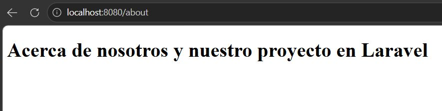
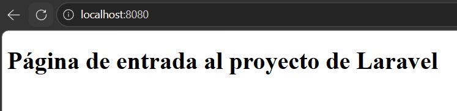
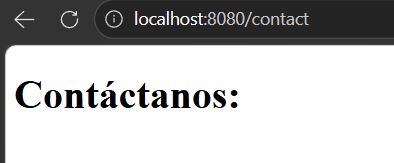

# Tema 01: Laravel

| | |
|---|---|
| **Fecha de inicio** | 16/11/2026 |
| **Fecha de fin** | 23/11/2026 |
| **Tiempo dedicado** | 3 horas |
| **Rama de Git** | `Tema 1` |

---

## 1. 🎯 Objetivo del tema

Instalacion del proyecto con Docker y creacion del proyecto laravel.

## 2. 🛠️ Desarrollo paso a paso

## 2.1 Creacion de vistas
Creación de 3 vistas llamadas : home, about, contact. \
Vista about.blade.php:
```php
<!DOCTYPE html>
<html lang="en">
<head>
    <meta charset="UTF-8">
    <meta name="viewport" content="width=device-width, initial-scale=1.0">
    <meta http-equiv="X-UA-Compatible" content="ie=edge">
    <title>Document</title>
</head>
<body>
    <h1>Acerca de nosotros y nuestro proyecto en Laravel</h1>
</body>
</html>
```
Vista home.blade.php
```php
<!DOCTYPE html>
<html lang="en">
<head>
    <meta charset="UTF-8">
    <meta name="viewport" content="width=device-width, initial-scale=1.0">
    <meta http-equiv="X-UA-Compatible" content="ie=edge">
    <title>Document</title>
</head>
<body>
    <h1>Página de entrada al proyecto de Laravel</h1>
</body>
</html>
```
Vista contact.blade.php
```php
<!DOCTYPE html>
<html lang="en">
<head>
    <meta charset="UTF-8">
    <meta name="viewport" content="width=device-width, initial-scale=1.0">
    <meta http-equiv="X-UA-Compatible" content="ie=edge">
    <title>Document</title>
</head>
<body>
        <h1>Contáctanos:</h1>
</body>
</html>
```

## 2.2 Definicion de rutas
Se modifica el fichero routes/web.php de la siguiente forma :
```php
Route::view('/', 'landing.home')->name('home');
Route::view('/contact', 'landing.contact')->name('contact');
Route::view('/about', 'landing.about')-> name('about');
```
## 3. 📋 Resumen de comandos utilizados
Para qué sirve
`composer ...`
Gestor de dependencias de PHP. Se usa para instalar Laravel y sus paquetes necesarios.\
`docker-compose `
Herramienta para definir y ejecutar contenedores Docker. Útil para crear un entorno de desarrollo con Laravel.
## 4. 🐞 Problemas encontrados y soluciones
Problema 1: Comprobacion del funcionamento de Laravel despues de su instalacion
Qué estaba haciendo: Comprobar el correcto funcionamento de Laravel una vez creado el proyecto basico.
Error:
```
Acceso denegado
```
Causa: Posible problema de permisos .
Solución:
Ejecutamos en una terminal los seguientes comandos :
```bash
docker exec -it proyecto-php-1 bash
php artisan key:generate
chmod -R 775 storage bootstrap/cache
chown -R www-data:www-data storage bootstrap/cache
```
Poateriormente sera necesario añadir en el fichero .env la siguiente configuracion:
```bash
Fichero .env:
DB_HOST=mysql
DB_PORT=3306
DB_DATABASE=test
DB_USERNAME=alumno
DB_PASSWORD=alumno
SESSION_DRIVER=file
```
Fuente: chat de teams de la asignatura.

## 5. ✅ Resultado final

Vista about.blade.php

Vista home.blade.php

Vista contact.blade.php


## 6. 💭 Conclusiones

Qué he aprendido: A realizar una instalación íntegra de Laravel. \
Qué me ha costado más: Acostumbrarme a hacer un uso adecuado de los contenedores \
Qué haría diferente / dudas pendientes: Nada.